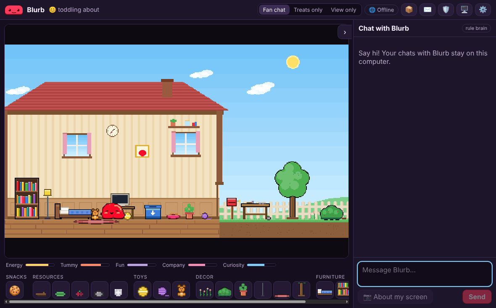
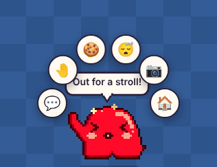
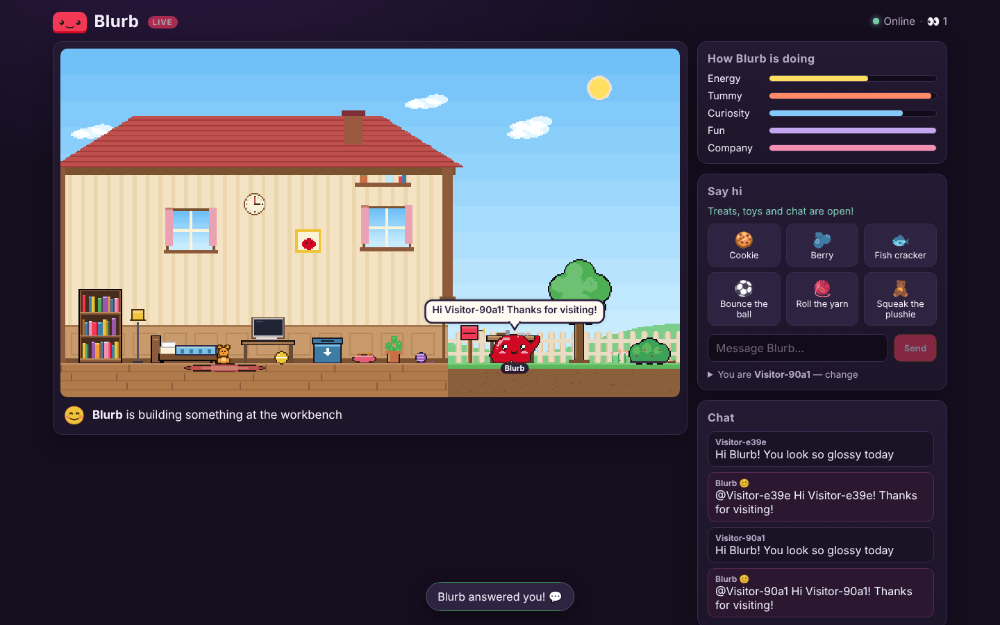

# Blurb — an AI desktop pet with a little world and a live fan page

Blurb is a glossy pixel blob that lives in a cozy house with a yard. It gets sleepy, hungry, bored and curious; it naps, eats, reads, forages, builds, and tinkers at its computer. Minimize the window and Blurb hops out onto your real desktop — walking along the taskbar, climbing onto windows, chasing your cursor. A public web page lets fans watch its little world live and send treats, toys and (moderated) messages.

| House window | Out on the desktop | Fan page |
|---|---|---|
|  |  |  |

The sprite is procedurally generated from the three reference designs in `assets/reference/` (palettes sampled from them), so every skin, squash, blink, expression and Blurb-designed shape comes out of one generator.

---

## Quick start

Requires Node ≥ 20.18.

```bash
cd blurb
npm install                 # downloads Electron (~100 MB)
npm test                    # 59 tests: shared, engine, llm, server, end-to-end

# Desktop app
npm run dev:desktop

# Relay + fan page (optional)
npm run build -w @blurb/web
ROOM_TOKENS=blurb:pick-a-long-random-token WEB_DIST=packages/web/dist npm run dev:server
# → open http://localhost:8787, then in the app: Settings → Live page → URL ws://localhost:8787/ws,
#   pet id "blurb", paste the same token, tick "Go live", Save.

# No desktop handy? Run the real pet logic headless against the relay:
PET_TOKEN=pick-a-long-random-token npm run headless
```

If the Electron download is blocked on your network, set `ELECTRON_MIRROR` before `npm install`.

---

## Architecture

```
packages/
  shared/   Phase 1 — schema (PetState, WorldObject, ChatMessage, LLMConfig…), catalog, BlurbScript validator,
            tag parser, fan-safety filters, rate limiter, public-state projection + delta codec, WS protocol
  render/   Canvas renderer used by BOTH the desktop and the fan page (procedural sprite, scene, objects, particles)
  engine/   PetSim (needs, utility AI, interactions, crafting, drop box, comm box, BlurbScript executor)
            DesktopSim (overlay physics: taskbar, window-climbing, cursor chasing, napping)
  llm/      Phase 3 — LLMProvider interface, OpenAI-compatible + native Anthropic streaming adapters,
            prompts, owner-priority chat queue, JSON memory store, GGUF discovery / llama-server / Hugging Face
  host/     PetHost: runs sim + brain + fan moderation + memory + relay publishing (no UI)
  desktop/  Phase 2 — Electron: house window, per-display transparent overlays, keychain, IPC, React UI
  server/   Phase 4 — Fastify + ws relay: rooms, owner auth, fan guard, static hosting of the fan page
  web/      Phase 4 — React fan viewer
scripts/    headless-pet.ts, render-sprites.ts (sprite sheet preview), make-icons.ts
```

Data flow:

```
 Electron main ──────────────────────────────────────────────┐
 │ PetHost ─ PetSim (30 Hz) ─ DesktopSim (overlay mode)      │
 │    │  └─ LLMProvider (local or cloud) ◄── prompts/memory  │
 │    ├─ localState() ──IPC──► house window (private bubbles)│
 │    ├─ overlay frames ─IPC─► transparent overlay windows   │
 │    └─ publicState() ─ delta ─► RelayClient ───────────────┼──► relay server ──► fan pages
 │                                fan events ◄───────────────┼─── (filtered, rate-limited, moderated)
 └───────────────────────────────────────────────────────────┘
```

**The simulation runs in the Electron main process**, not a renderer. That's why the fan page keeps updating when the window is minimized (minimized renderers get throttled).

---

## The rules you gave Blurb, and how they're enforced

**"Blurb can do basic coding … but cannot give itself new abilities."** When Blurb sits at its computer, the LLM is asked for a short JSON program in *BlurbScript*. That program is **data, not code**: it's parsed and every instruction is checked against a closed whitelist plus your capability switches before the engine applies it. There is no `eval`, and the grammar has no instruction for flying, inventing object kinds, files, apps or the network — so "can't give itself new powers" is a property of the grammar, not a promise in a prompt.

| Instruction | What it can do | Limits |
|---|---|---|
| `recolor` | Paint itself or any object | color only |
| `transform` | tree ↔ bush ↔ flowers, ball ↔ yarn ↔ plushie | same family, allowed zone |
| `move` | Rearrange the house/yard | trees stay in the yard, etc. |
| `build` | Add a **copy** of something that already exists | costs resources; no unique items; world cap |
| `set_skin` / `set_shape` | Wear anything in the drop box | only approved shapes |
| `design_shape` | Propose a new blob shape | parameters clamped; **you approve it in the comm box** before it enters the drop box |
| `note` | Leave you a note | text only |

Rejected instructions are shown to you in the chat log ("⛔ refused: unknown instruction 'fly'"). Every switch lives in **Settings → Abilities**. Physics enforces the rest: Blurb walks, hops, falls, and (being sticky) climbs window edges — it has no vertical locomotion besides that.

Resources: Blurb forages trees (sticks, leaves) and bushes (berries, leaves), picks up things that wash up in the yard, or collects what you put in the drop box. All three reference colors are in the drop box from the start; Blurb swaps between them freely.

---

## Privacy model (what leaves your computer)

`toPublicState()` is a **whitelist projection**: it builds a fresh object from named fields, so a new internal field can't leak by accident. Only that object and Blurb's replies to fans are ever sent to the relay.

Never sent: your screen, screenshots, window titles or rectangles, Blurb's desktop coordinates, display layout, your private chat with Blurb, memories, settings, API keys, the relay token.

- While Blurb is out on your desktop, fans see an abstract postcard ("perched on top of a window") — no real geometry.
- Window titles are discarded at the OS-query boundary (`desktop-env.ts`); the app only ever holds window ids + rectangles.
- Screenshots happen only when you click "📷 About my screen" (or opt in to peeks). They go to *your* AI provider only — with a cloud provider that means they leave your machine; with Ollama/LM Studio/GGUF they don't. Peeks are off by default and refuse cloud providers unless you tick a separate box.
- Owner chat is private by default (toggle in 🛡️ Fans).
- An end-to-end test (`packages/host/test/e2e.test.ts`) runs the real host → real relay → a fan socket and asserts a private message, desktop geometry and the token never appear in any frame the fan receives.

**Honest caveat:** like any server you connect to, the relay sees the IP address the desktop connects from — that's how TCP works. Blurb never forwards it to fans and the relay doesn't log it, but if that matters, self-host the relay or connect through a VPN.

---

## Fan safety

- **Modes:** Fan chat · Treats only (treats + toys, no chat) · View only. Enforced on the server and again on the desktop.
- **Moderation:** fan messages stay private until your app approves them (manual queue, or auto-approve). Only then do they appear publicly.
- **Owner priority:** your messages jump the queue and abort an in-flight fan reply (which is retried once afterwards).
- **Rate limits:** token buckets per fan, per IP-hash and per room. Filter-rejected messages still spend tokens, so the filter can't be probed at speed.
- **Filters:** NFKC normalization, zero-width stripping, leetspeak-aware profanity list, prompt-injection and owner-impersonation patterns, link blocking, control-tag stripping.
- **The real boundary:** heuristic filters are leaky by nature. What actually protects you is that fan-context replies run with a reduced action whitelist (emotions, wave, dance) — an injection that slips through can make Blurb *say* something odd, never *do* anything privileged.

---

## AI brain

Settings → Brain. Everything except Anthropic goes through one OpenAI-compatible adapter.

| Provider | Where it runs | Notes |
|---|---|---|
| Rule brain (default) | local | No AI; built-in behaviors + keyword chat |
| Ollama | local | `http://localhost:11434/v1` |
| LM Studio | local | `http://localhost:1234/v1` |
| GGUF file | local | Scans HF cache, LM Studio, GPT4All, `~/models`, `~/Downloads`; can search/download from Hugging Face. **Requires llama.cpp's `llama-server`** (`brew install llama.cpp`, `winget install llama.cpp`, or set `BLURB_LLAMA_SERVER`). |
| OpenAI / Gemini / OpenRouter / custom | cloud | OpenAI-compatible endpoints |
| Anthropic | cloud | Native Messages API streaming |

Keys are stored with Electron `safeStorage` (macOS Keychain, Windows DPAPI, libsecret/KWallet). On Linux without a keyring the app says so instead of pretending.

Replies stream token by token; `[[emotion:happy]]` / `[[action:nap]]` tags are parsed mid-stream (split tags are held back, so bubbles never flash raw tags) and drive the face and behavior. Autonomous "thoughts" run every N seconds (configurable) and deliberately exclude memories, since thoughts are spoken in the public world. Memory is a local JSON file you can inspect and delete from Settings → Memory.

---

## Deploying the relay

```bash
npm run build -w @blurb/web && npm run build -w @blurb/server
ROOM_TOKENS=blurb:<token> WEB_DIST=packages/web/dist node packages/server/dist/main.js
```

Put it behind Caddy/nginx for TLS (`wss://`), set `TRUST_PROXY=1` only then. See `packages/server/.env.example`.

---

## What's verified, and what isn't

Verified in this repo's CI-style run (Linux, headless):
- 59 unit/integration tests, including the end-to-end privacy test and a full moderation round trip.
- The Electron app built and launched under Xvfb: chat (rule brain), skin change by chat, comm-box approval → shape appears in drop box and is worn, drop box, settings, the overlay window (always-on-top, non-focusable, transparent) and its radial menu.
- The fan page at desktop and phone widths, no console errors, no horizontal overflow.

Not verified here, and worth testing on real machines:
- **Click-through on a real desktop.** Hit-testing polls the cursor in main and toggles `setIgnoreMouseEvents`; Xvfb has no window manager, so real minimize/restore and OS-level pass-through weren't exercised.
- **Window-sitting** uses the optional `get-windows` module (macOS/Windows) or `xdotool` (X11). On **Wayland** there is no portable way to read other windows' geometry, so Blurb sticks to the bottom of the screen.
- **macOS permissions:** screenshots need Screen Recording permission.
- **Live providers:** adapters are tested against mocked streaming servers that reproduce each wire format; no real API keys were used.
- **Packaging/signing:** no installer config yet (`electron-builder` is the natural next step).
